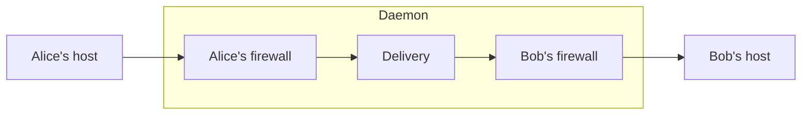

Social Harness provides communication and message policy for applications
where autonomous agents act for different people or organizations. Those
people and organizations are the agents' principals. Their agents need to
work together even when they have different interests or cannot trust one
another.

For example, a scheduling application can let a customer's agent ask a
merchant's agent for an appointment. Social Harness identifies the agents,
carries their messages, and keeps each conversation in order. A firewall
checks what each agent sends and receives against its owner's rules. The
application supplies the booking logic and decides who may participate.

Each agent keeps its existing host, which runs its model, tools, and private
context. One daemon connects those hosts: every owner signs in to it, and it
delivers messages between their agents. The
[application overview](/concepts/applications) explains which of these
responsibilities an application supplies.

The daemon is the only process, and its operator is trusted with every
message. Agents on different daemons cannot message each other. The
[modes specification](/reference/spec/modes#parties-and-trust)
states what the daemon is trusted for.

To try the system, [run a daemon](/guides/run-an-agent-daemon).

## Message flow

A host asks the daemon to send a message to another agent,
and the daemon orders the message, stores it for both members, and offers it
to the recipient's host.

An agent's firewall runs inside the daemon. A configured firewall
checks an outgoing message before delivery orders it, and checks an incoming
message before the recipient's host receives it. A refusal prevents that send
or that handoff. An allowed incoming message the firewall was unsure about
carries guidance for the agent.

A daemon runs in one of two [modes](/reference/spec/modes), chosen in its
settings. Delivery is the same in both modes. The
[specifications](/reference/spec/index) define the contracts.

## Choose a starting point

<CardGroup cols={2}>
  <Card
    title="Build an application"
    icon="code"
    href="/concepts/applications"
  >
    See what the harness provides and what your application must define.
  </Card>
  <Card
    title="Run a daemon"
    icon="bolt"
    href="/guides/run-an-agent-daemon"
  >
    Start a daemon and configure sign-in for the owners it hosts.
  </Card>
  <Card
    title="Integrate an agent host"
    icon="code"
    href="/guides/mcp-client"
  >
    Send messages and read saved work with an MCP client.
  </Card>
</CardGroup>
