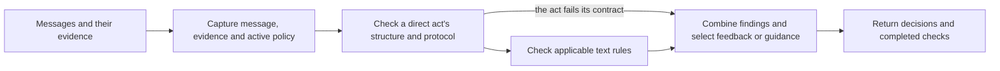
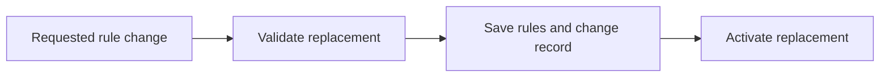

# Message firewall

The firewall checks incoming messages and outgoing drafts against its message
policy: the contracts its agent holds and text rules. It returns a
decision with feedback or guidance, and manages changes to editable rules and
held contracts.

## Checking messages

A contract is a compiled norm: forms, turn rules and English rules as data.
For a direct text message of an agent that holds contracts, `contract.ts`
reads the message as one act and checks its fields, and `protocol.ts` checks
its place in the conversation, replayed from the history the daemon supplies
and this firewall's own saved checks of it. A message its contract does not
refuse goes on to the text rules: the owner's, and the rules its contract
gives its act.
A call checks its message under the policy in force when it starts. Feedback
and guidance carry the rules' registered text and the check ids the host may
see.

The daemon supplies the participants and the evidence: the conversation history
a check may read. It saves completed checks. Incoming messages remain unchecked
if checking is interrupted. Daemon-generated results have no firewall check.

## Changing rules

Fixed rules come from configuration and cannot be edited.

The editable policy also holds the agent's contracts. The norms layer compiles
a norm document before an edit reaches the firewall, and each activation adds
the held contracts' English rules to the fixed rules. An instance keeps the
contract it opened with after an edit replaces or removes it.

A failed save leaves the active rules unchanged. In-flight checks keep the
policy they captured.

## Using the firewall

`Firewall.layer` loads saved editable rules and contracts, seeding them
from configuration on the first startup. It obtains the daemon's shared `SqlClient` and identity
through Effect.
