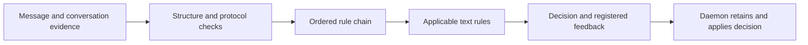

# Message firewall

The firewall checks incoming messages and outgoing drafts against configured
contracts, an ordered rule chain and text rules. It owns assessments and policy
edits; the daemon owns transport and delivery.

Contracts are typed configuration: forms, transitions, field relationships and
English rules. They do not add delivery acknowledgments or schedule model turns.
A chain allow preserves required contract checks. Matchers on text rules select
scope; the decision provider assesses compliance. Incoming feedback is itself
an outgoing candidate and must pass policy before it can be sent.

`Firewall.layer` loads retained editable rules and contracts, seeding only a
missing policy from configuration. Edits save the replacement and activation
record together. A failed save leaves the active policy unchanged; in-flight
checks retain the policy they captured.

The daemon supplies verified participants and permitted conversation evidence.
The firewall joins that history to its saved assessments to reconstruct protocol
state. The caller saves completed checks in its transaction with the affected
message or inbox record.

The test entry exports `DecisionProviderOverride` to exercise the daemon's own
composition with a deterministic provider.
