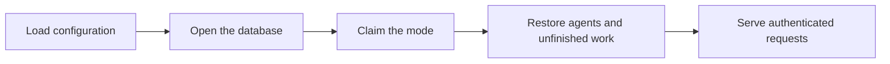
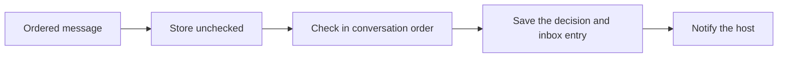
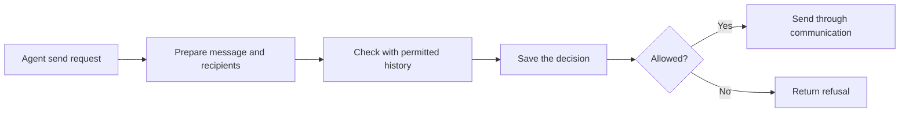

# Agent daemon

The daemon admits each request as its owner's agent and connects that agent's
communication, firewall and durable inbox. It checks new messages and stores
each permitted one as an inbox entry before notifying the host. `startup.ts` chooses the mode,
P2P or client/server, once and builds every agent from it.

## Startup

The daemon provides one `SqlClient` layer, for SQLite or PostgreSQL, for its
lifetime. Every agent's communication, firewall and delivery operations share
it. Closing the daemon's scope closes the database. An owner's first request
creates that owner's agent, and each agent loads its firewall rules when it
starts.

## Incoming messages

Each conversation advances independently. Later checks use the history the
agent was permitted to see. History reads return the stored inbox entries.

The decision and inbox entry commit together. Interrupted checks leave
messages unchecked for recovery. Daemon-generated results enter the inbox directly.

## Outgoing messages

Communication owns acceptance and ordering. A firewall approval allows the
send. It does not guarantee that communication accepts the message.

## Durable state

Domain operations decode saved values with their owning Effect Schemas and use
SQL transactions for related writes.
Delivery changes an inbox entry's status and leaves its content stored.

The database layer rejects incompatible state before serving requests. Recovery
restores accepted work before new requests begin.
